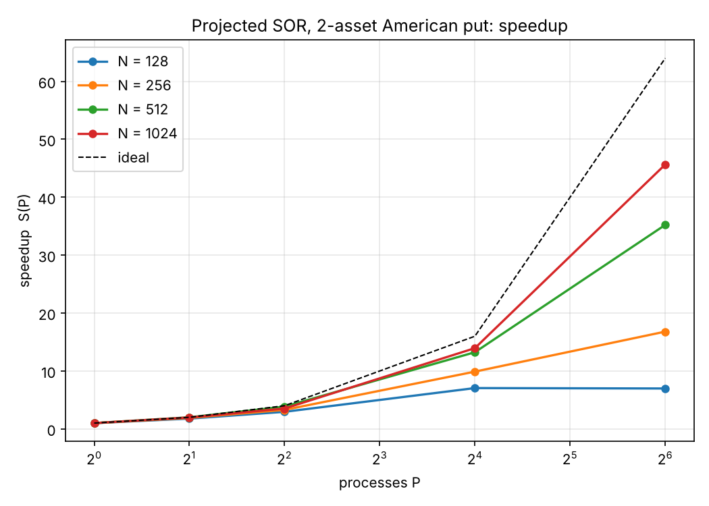
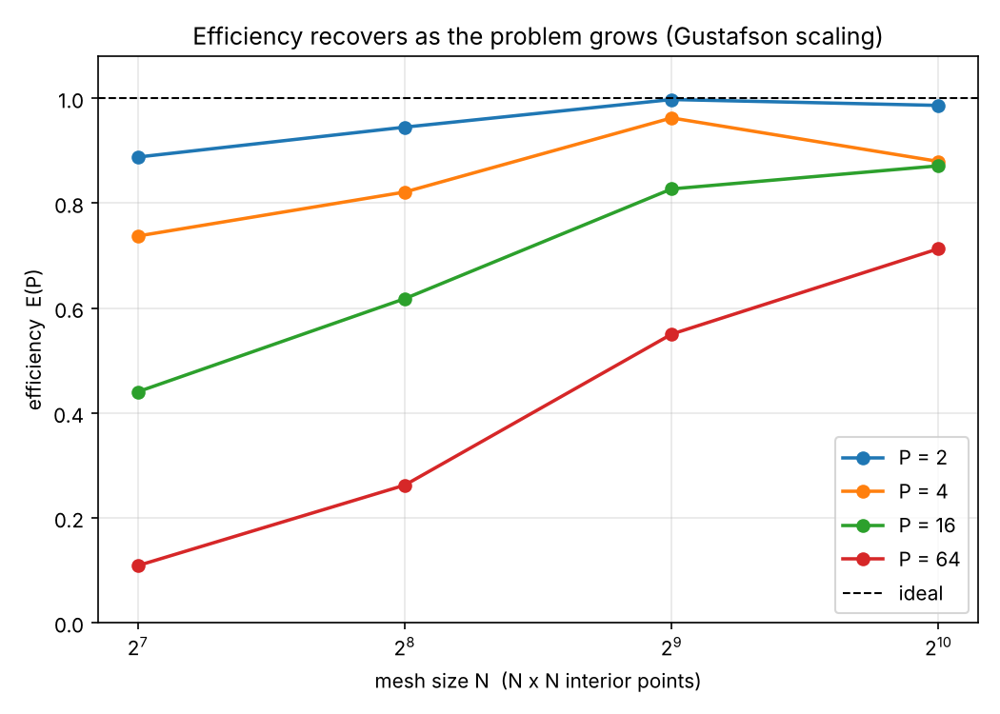

# Parallel Pricing of Two-Asset American Options by Projected SOR
 
Distributed-memory solver for the two-asset Black-Scholes PDE with an
early-exercise constraint, formulated as a sequence of **linear complementarity
problems** and solved by **projected SOR** with red-black ordering over a 2-D
MPI domain decomposition.
 
**45.65× speedup on 64 cores** at a 1024×1024 mesh (71.3% efficiency,
Karp-Flatt 0.0064), measured on three 28-core Intel Xeon E5-2683 v3 nodes.
 
> AMS 530: Principles of Parallel Computing · Stony Brook University
> Project 3, Problem 3.5 · November 2026
 
---
 
## Why an American option is hard
 
A European option has no decision in it. Its value is a conditional
expectation, it satisfies Black-Scholes with equality everywhere, and
discretising implicitly gives one sparse linear system per time step.
 
An American option can be exercised at any moment. That freedom splits the
domain into a **continuation region**, where holding is optimal and the PDE
holds exactly, and an **exercise region**, where the value equals the payoff
and the PDE becomes an inequality. The interface between them is a *free
boundary* whose location is unknown in advance and moves with time. There is no
closed form.
 
Rather than track that boundary, this solver imposes three conditions at once:
 
```
V − Φ ≥ 0            the option is never worth less than immediate exercise
AV − Vⁿ ≥ 0          the PDE degrades to an inequality where exercise is optimal
(V − Φ)ᵀ(AV − Vⁿ) = 0   at every node, one of the above holds with equality
```
 
The free boundary is never computed. It is **revealed**, as the set where the
active condition changes.
 
In code, the entire American feature is one line:
 
```c
vn = V[q] + omega * (gs - V[q]);
if (american && vn < Phi[q]) vn = Phi[q];   /* projection onto {V ≥ Φ} */
```
 
Delete it and you have a European option. That is what the `-e` flag does, and
it is what makes the validation below possible.
 
---
 
## Results
 
### Speedup
 

 
### Efficiency is governed by surface-to-volume
 

 
At every fixed core count, efficiency rises monotonically with mesh size. At
P = 64 it climbs from 10.9% to 71.3%. The mechanism is geometric: a rank owning
an n×n block computes on n² points and communicates 4n, so the
communication-to-computation ratio falls as 1/n.
 
| P | block per rank | halo : interior | measured comm % |
|---|---|---|---|
| 1 | 1024×1024 | 0.004 | 0.3% |
| 4 | 512×512 | 0.008 | 3.1% |
| 16 | 256×256 | 0.016 | 20.1% |
| 64 | 128×128 | 0.031 | 21.8% |
 
### Headline performance, N = 1024
 
| P | grid | time (s) | speedup | efficiency | Karp-Flatt |
|---|---|---|---|---|---|
| 1 | 1×1 | 824.617 | 1.00 | 1.000 | — |
| 2 | 2×1 | 417.954 | 1.97 | 0.986 | 0.0137 |
| 4 | 2×2 | 234.357 | 3.52 | 0.880 | 0.0456 |
| 16 | 4×4 | 59.151 | 13.94 | 0.871 | 0.0098 |
| 64 | 8×8 | 18.065 | **45.65** | **0.713** | **0.0064** |
 
At N = 128 the speedup actually *turns over*, falling from 7.05 at P = 16 to
6.98 at P = 64 with communication at 86.6% of runtime. Each rank there holds a
16×16 block ringed by a 64-cell halo, so a quarter of the data it owns is
boundary. The solver wants roughly 10⁴ interior points per rank to stay
efficient.
 
---
 
## Correctness
 
Three independent checks, one of them analytic.
 
**1 · The answer does not depend on how the mesh is cut.** Red-black colouring
is assigned from *global* indices, so the iterate sequence is a property of the
mathematics rather than of the decomposition.
 
| P | grid | SOR iterations | ‖V‖₂ | V(K,K) |
|---|---|---|---|---|
| 1 | 1×1 | 27928 | 1.3489710295e+04 | 16.9934552067 |
| 2 | 2×1 | 27928 | 1.3489710295e+04 | 16.9934552067 |
| 4 | 2×2 | 27928 | 1.3489710295e+04 | 16.9934552067 |
| 16 | 4×4 | 27928 | 1.3489710295e+04 | 16.9934552067 |
| 64 | 8×8 | 27928 | 1.3489710295e+04 | 16.9934552067 |
 
Identical to eleven digits, across three physical nodes. Not agreement to a
tolerance — the same arithmetic, distributed differently.
 
**2 · The European limit reproduces Black-Scholes.** The payoff
`max(K₁−S₁,0) + max(K₂−S₂,0)` is separable, so by linearity of expectation the
exact European value is the sum of two 1-D Black-Scholes puts. Disabling the
projection recovers it to **0.33%**, the residual being the payoff kink at the
strike (classical for finite differences on a non-smooth terminal condition).
 
**3 · An exact test of the projection.** Deep in the money the American put is
worth its strike immediately while the European holder must wait, so the gap
for the pair is analytically `2K(1 − e^(−rT)) = 9.7541151`. The solver reports
**9.754115** — seven significant figures, at a point where the free boundary is
unambiguous. Financially, that quantity is the interest earned on the strike
over the remaining life, which is exactly what early exercise buys.
 
Puts, not calls, by design: on a non-dividend-paying asset an American call is
never exercised early (Merton), the continuation region would fill the domain,
and the projection would never bind.
 
---
 
## Build and run
 
```bash
mpicc -O3 -std=c99 -Wall -o psor2d src/psor2d.c -lm
 
mpirun -np 16 ./psor2d -M 512 -n 50        # American
mpirun -np 16 ./psor2d -M 512 -n 50 -e     # European (projection off)
```
 
| flag | meaning | default |
|---|---|---|
| `-M` | interior points per dimension | 256 |
| `-n` | backward-Euler time steps | 50 |
| `-w` | relaxation factor ω | `2/(1+sin(π/(M+1)))` |
| `-t` | SOR tolerance | 1e-7 |
| `-e` | European (disable projection) | off |
 
On a Slurm cluster:
 
```bash
sbatch src/run35.slurm
python3 src/collectp3.py psor35_<jobid>.out    # tables + figures
```
 
---
 
## Repository layout
 
```
├── README.md
├── report/
│   └── AMS530_Project3_Problem3.5.pdf    full write-up, 21 pp.
├── src/
│   ├── psor2d.c                          MPI solver
│   ├── run35.slurm                       sweep: P ∈ {1,2,4,16,64}, N ∈ {128..1024}
│   └── collectp3.py                        parses output → tables + figures
├── results/
│   ├── psor35_106897.out                 raw run output (29 measurements)
│   └── tables_106897.txt                 formatted tables
└── figures/
    ├── fig1_speedup.png
    ├── fig2_efficiency.png
    ├── fig3_commfrac.png
    └── fig4_gustafson.png
```
 
---
 
## Implementation notes
 
**Discretisation.** Substituting τ = T − t reverses the integration so the
payoff becomes an initial condition. Backward Euler then gives
`(I − Δτ·L)Vⁿ⁺¹ = Vⁿ`, where L carries the same five-point stencil as a Poisson
problem. The assets are uncorrelated, so there is no mixed partial and the
stencil stays five-point; a correlated pair would need nine points and a wider
halo.
 
**Convergence is not assumed.** The convection terms `rS·V_S` could render an
off-diagonal weight positive and destroy the M-matrix property that projected
SOR relies on. The condition reduces to `i ≥ r/σ²`, which is 0.56 and 0.80 for
the two assets, satisfied at every interior node. The matrix is a strictly
diagonally dominant M-matrix.
 
**Parallel structure.** Blocks over an `MPI_Dims_create` Cartesian
communicator; one-cell halo; contiguous rows sent directly, strided columns
packed first; eight non-blocking transfers closed by a single `MPI_Waitall`;
one `MPI_Allreduce` per sweep for convergence. Timing is taken from the slowest
rank via `MPI_MAXLOC` and broadcast.
 
**The projection costs nothing in parallel.** `max(V, Φ)` is pointwise. It
consults no neighbour, crosses no subdomain boundary, and adds no message. The
feature that makes the problem analytically intractable is free to distribute.
 
**A caveat we do not paper over.** At N = 1024 the absolute communication time
is non-monotone in P (11.89 s at P = 16 against 3.93 s at P = 64). The reported
figure is the slowest rank's own time inside MPI, which conflates message cost
with waiting for stragglers; at P = 64 the allocation places 28/28/8 ranks
across three nodes. Separating the two requires per-rank min/mean/max
reporting. We state the limitation rather than advance an untested mechanism.
 
**Why no cache cliff.** A companion project saw a sharp L3 capacity cliff on
this same hardware, because each rank held a full copy of an operand and the
per-socket footprint grew as `(P/2)(N² + 2N²/P)·8` bytes. A domain
decomposition replicates nothing: per-socket footprint is `≈16N²` bytes,
*independent of P*. At N = 1024 that is 16.8 MiB against 35 MiB of shared L3,
which is why per-rank throughput stays flat at 1.2–1.5 ×10⁸ updates/s across a
64-fold change in core count. Setting `16N² = 35 MiB` predicts the crossing at
**N ≈ 1480**, so N = 2048 should reproduce the cliff and N = 1024 should not.
 
---
 
## Environment
 
SeaWulf (Stony Brook University) · `short-28core` partition · 3 nodes ×
28 cores · Intel Xeon E5-2683 v3 @ 2.00 GHz, 2×14 cores, 35 MiB L3 per socket ·
mvapich2/gcc12.1/2.3.7 · jobs run `--exclusive`.
